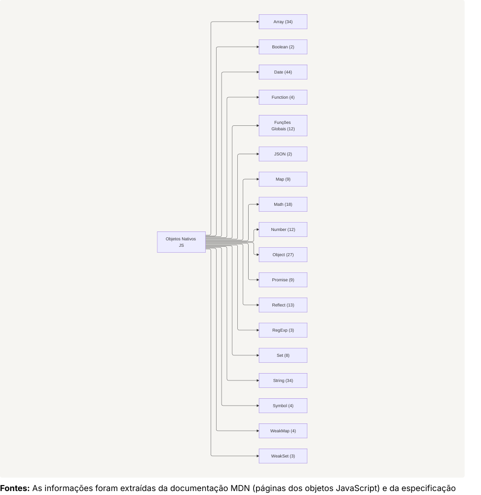

# JavaScript do básico ao avançado (c/ Node.js e projetos)

- Seção 1: Introdução
- Seção 2: Tipos de dado e operadores lógicos
- Seção 3: Exercícios sobre tipos de dados
- Seção 4: Estruturas de Programação
- Seção 5: Exercícios sobre estrutura de programação
- Seção 6: Funções
- Seção 7: Exercícios sobre funções
- Seção 8: Arrays e Objetos
- Seção 9: Exercícios sobre arrays e objetos
- Seção 10: Conceito de orientação a objetos
- Seção 11: Exercícios sobre orientação a objetos
- Seção 12: Debugs e erros no JavaScript
- Seção 13: Expressões Regulares
- Seção 14: Exercícios sobre Expressões Regulares
- Seção 15: Programação Assíncrona com JavaScript
- Seção 16: JavaScript e o navegador
- Seção 17: Eventos com JavaScript
- Seção 20: Aprendendo Node.js
- Seção 23: JavaScript moderno (ES6)

---

## 🔥 TABELA SIMPLES

### 📌 1️⃣ Selecionar elementos (mais usado)

| Função | O que faz |
|---|---|
| `getElementById()` | pega pelo ID |
| `getElementsByClassName()` | pega pela classe |
| `getElementsByTagName()` | pega pela tag |
| `querySelector()` | pega o primeiro (melhor hoje) |
| `querySelectorAll()` | pega vários elementos |

👉 Esses são os MAIS IMPORTANTES

### 📌 2️⃣ Manipular elementos

| Função | O que faz |
|---|---|
| `textContent` | muda texto |
| `innerHTML` | muda HTML |
| `style` | muda CSS |
| `setAttribute()` | adiciona atributo |

### 📌 3️⃣ Criar e remover elementos

| Função | O que faz |
|---|---|
| `createElement()` | cria elemento |
| `appendChild()` | adiciona elemento |
| `remove()` | remove elemento |

### 📌 4️⃣ Eventos (INTERAÇÃO DO USUÁRIO)

| Função | O que faz |
|---|---|
| `addEventListener()` | escuta eventos |
| `click` | clique |
| `input` | digitação |
| `change` | mudança |
| `submit` | envio |

👉 Isso faz o sistema reagir ao usuário

### 💼 Exemplo REAL (pra conectar tudo)

```html
<button id="btn">Clique</button>
<p id="texto"></p>
```

```javascript
const botao = document.getElementById("btn");

botao.addEventListener("click", () => {
    document.getElementById("texto").textContent = "Você clicou!";
});
```

👉 Aqui você usou:

- `getElementById` ✅
- `addEventListener` ✅
- `textContent` ✅

👉 Isso é literalmente como sistemas funcionam

### 🚀 Dica MUITO importante (isso vai te acelerar)

Você NÃO precisa decorar tudo.

👉 Foque só nesses 5 primeiros:

- `getElementById`
- `querySelector`
- `addEventListener`
- `textContent`
- `createElement`

👉 Com isso você já constrói um sistema real

### 📊 Métodos de Array (os mais usados)

| Método | Para que serve |
|---|---|
| `push()` | Adiciona um item no final do array |
| `pop()` | Remove o último item do array |
| `shift()` | Remove o primeiro item do array |
| `unshift()` | Adiciona um item no início do array |
| `map()` | Cria um novo array transformando os itens |
| `filter()` | Cria um novo array com itens que passam em uma condição |
| `reduce()` | Reduz o array a um único valor (ex: soma) |
| `forEach()` | Percorre o array executando uma função (não retorna nada) |
| `find()` | Retorna o primeiro item que atende uma condição |
| `findIndex()` | Retorna o índice do item que atende uma condição |
| `some()` | Retorna `true` se pelo menos um item atender a condição |
| `every()` | Retorna `true` se todos os itens atenderem a condição |
| `includes()` | Verifica se o array contém um valor |
| `indexOf()` | Retorna a posição de um item |
| `join()` | Junta os itens do array em uma string |
| `slice()` | Retorna uma cópia de parte do array |
| `splice()` | Remove ou adiciona itens em qualquer posição |

### 💡 Exemplos rápidos (pra fixar de verdade)

#### 🔁 `map()`

```javascript
let numeros = [1, 2, 3];

let dobrado = numeros.map(n => n * 2);
// [2, 4, 6]
```

#### 🔍 `filter()`

```javascript
let numeros = [1, 2, 3, 4];

let pares = numeros.filter(n => n % 2 === 0);
// [2, 4]
```

#### ➕ `reduce()`

```javascript
let numeros = [1, 2, 3];

let soma = numeros.reduce((acc, n) => acc + n, 0);
// 6
```

### 📊 Tipos de Dados

| Tipo | Exemplo | typeof |
|---|---|---|
| Number | 10, 3.5 | "number" |
| String | "Olá" | "string" |
| Boolean | true | "boolean" |
| Null | null | "object" ⚠️ (peculiar do JS) |
| Undefined | undefined | "undefined" |

### 🔍 Operadores de Comparação

| Operador | Significado | Exemplo | Resultado |
|---|---|---|---|
| `>` | Maior que | 5 > 3 | true |
| `<` | Menor que | 2 < 1 | false |
| `>=` | Maior ou igual | 5 >= 5 | true |
| `<=` | Menor ou igual | 4 <= 3 | false |
| `==` | Igual (com conversão de tipo) | 5 == "5" | true |
| `!=` | Diferente | 5 != "5" | false |
| `===` | Idêntico (valor e tipo) | 5 === "5" | false |
| `!==` | Não idêntico | 5 !== "5" | true |

### 🧠 Operadores Lógicos

| Operador | Nome | Significado | Exemplo | Resultado |
|---|---|---|---|---|
| `&&` | AND | Verdadeiro se **tudo for verdadeiro** | true && false | false |
| `\|\|` | OR | Verdadeiro se **um for verdadeiro** | true \|\| false | true |
| `!` | NOT | Inverte o valor | !true | false |

### 📈 Tabela da Verdade

| A | B | A && B | A \|\| B | !A |
|---|---|---|---|---|
| false | false | false | false | true |
| false | true | false | true | true |
| true | false | false | true | false |
| true | true | true | true | false |

### 💡 O que é uma função *built-in* no JavaScript?

Uma **função built-in** (ou função nativa) é uma função que **já vem pronta dentro do JavaScript**, você não precisa criar.

Exemplos:

| Função | O que faz | Exemplo |
|---|---|---|
| `parseInt()` | Converte texto em número inteiro | `parseInt("10")` → 10 |
| `parseFloat()` | Converte para número decimal | `parseFloat("10.5")` → 10.5 |
| `toString()` | Converte para texto | `(10).toString()` → "10" |
| `isNaN()` | Verifica se não é número | `isNaN("abc")` → true |
| `Math.random()` | Gera número aleatório | `Math.random()` → 0.123... |
| `String()` | Converte para string | `String(123)` → "123" |

👉 Ou seja: **Built-in = já vem pronta no JavaScript pra você usar.**

---

## Resumo Executivo

Para compilar esta tabela, consultamos a documentação oficial do JavaScript (MDN Web Docs e especificação ECMAScript) para identificar todos os métodos nativos estáticos e de protótipo dos principais objetos embutidos.

Incluímos funções globais (como `parseInt`, `isNaN` etc.) e métodos de String, Array, Object, Function, Number, Boolean, Date, RegExp, Promise, Map, Set, WeakMap, WeakSet, Symbol.

Cada método foi listado com seu nome exato (incluindo o tipo, ex.: `String.prototype.trim`), seguido de uma breve descrição em português, além da categoria ("Grupo/Tipo") correspondente. Métodos legados ou obsoletos (por exemplo, `String.prototype.substr`) foram marcados no texto.

Como resultado, foram catalogados **242 métodos/funções** no total. A seguir, são apresentados números resumidos por categoria (entre parênteses, o total de métodos incluídos):

- **String** (34 métodos)
- **Array** (34)
- **Object** (27)
- **Function** (4)
- **Number** (12)
- **Boolean** (2)
- **Date** (44)
- **RegExp** (3)
- **Promise** (9)
- **Map** (9)
- **Set** (8)
- **WeakMap** (4)
- **WeakSet** (3)
- **Symbol** (4)
- **Math** (18)
- **JSON** (2)
- **Reflect** (13)
- **Funções Globais** (12)

As descrições são baseadas nas definições do MDN Web Docs. A tabela completa (abaixo) lista cada método e sua finalidade em português. Para facilitar o uso prático, fornecemos também os dados em arquivos CSV e XLSX (anexos) com a mesma estrutura. O diagrama abaixo ilustra graficamente as categorias (grupos de métodos) com suas quantidades:



*Figura: diagrama (fluxo em árvore) de "Objetos Nativos JS" ligando cada grupo ao seu total de métodos: Array (34), Boolean (2), Date (44), Function (4), Funções Globais (12), JSON (2), Map (9), Math (18), Number (12), Object (27), Promise (9), Reflect (13), RegExp (3), Set (8), String (34), Symbol (4), WeakMap (4), WeakSet (3).*

**Fontes:** As informações foram extraídas da documentação MDN (páginas dos objetos JavaScript) e da especificação ECMAScript. Por exemplo, o MDN registra que `Array.from()` "cria uma nova instância de Array a partir de um objeto array-like ou iterável", e que `String.prototype.trim()` "remove espaços em branco do início e fim" de uma string. As citações acima ilustram o estilo das referências utilizadas para validar cada descrição.

## Tabela Completa em Markdown

| Grupo/Tipo | Método | Para que serve |
|---|---|---|
| String | String.fromCharCode | Cria string a partir de valores Unicode (códigos de caractere). |
| String | String.fromCodePoint | Cria string a partir de pontos de código Unicode. |
| String | String.raw | Função tag que retorna string bruta de template literal (escapes não processados). |
| String | String.prototype.charAt | Retorna o caractere na posição (índice) especificada. |
| String | String.prototype.charCodeAt | Retorna o código UTF-16 do caractere no índice dado. |
| String | String.prototype.codePointAt | Retorna o código de ponto Unicode do caractere no índice dado. |
| String | String.prototype.concat | Concatena uma ou mais strings e retorna nova string. |
| String | String.prototype.endsWith | Verifica se string termina com substring dada (true/false). |
| String | String.prototype.includes | Verifica se string contém a substring dada (true/false). |
| String | String.prototype.indexOf | Retorna o índice da primeira ocorrência de substring (ou -1 se não encontrado). |
| String | String.prototype.lastIndexOf | Retorna o índice da última ocorrência de substring (ou -1 se não encontrado). |
| String | String.prototype.localeCompare | Compara string com outra (sensível a localidade) retornando <0, 0, >0. |
| String | String.prototype.match | Retorna array de correspondências (regex) na string (ou null). |
| String | String.prototype.matchAll | Retorna um iterador com todas as correspondências (regex) na string. |
| String | String.prototype.normalize | Normaliza a string para uma forma Unicode (NFC, NFD, etc.). |
| String | String.prototype.padStart | Preenche a string no início até atingir o tamanho especificado (adiciona caracteres à esquerda). |
| String | String.prototype.padEnd | Preenche a string no fim até atingir o tamanho especificado (adiciona caracteres à direita). |
| String | String.prototype.repeat | Retorna nova string repetindo o original N vezes. |
| String | String.prototype.replace | Substitui parte do texto (string/regex) e retorna nova string. |
| String | String.prototype.replaceAll | Substitui todas ocorrências de string/regex por outro valor e retorna nova string. |
| String | String.prototype.search | Retorna o índice da primeira ocorrência que corresponde à regex (ou -1). |
| String | String.prototype.slice | Extrai parte da string entre índices e retorna como nova string. |
| String | String.prototype.split | Divide string em substrings (por separador) e retorna um array. |
| String | String.prototype.startsWith | Verifica se string inicia com substring dada (true/false). |
| String | String.prototype.substr | Extrai parte da string a partir de índice inicial por comprimento (legado, evite uso em novos códigos). |
| String | String.prototype.substring | Extrai parte da string entre dois índices e retorna nova string. |
| String | String.prototype.toLocaleLowerCase | Converte a string para minúsculas considerando a localidade. |
| String | String.prototype.toLocaleUpperCase | Converte a string para maiúsculas considerando a localidade. |
| String | String.prototype.toLowerCase | Converte a string para minúsculas. |
| String | String.prototype.toUpperCase | Converte a string para maiúsculas. |
| String | String.prototype.trim | Remove espaços em branco do início e fim da string. |
| String | String.prototype.trimStart | Remove espaços em branco do início (esquerda) da string. |
| String | String.prototype.trimEnd | Remove espaços em branco do final (direita) da string. |
| String | String.prototype.valueOf | Retorna o valor primitivo (string) do objeto String. |
| String | String.prototype.toString | Retorna o valor primitivo da string (mesmo que valueOf). |
| Array | Array.from | Cria um array a partir de um objeto iterável ou array-like. |
| Array | Array.isArray | Retorna true se o valor é um Array, caso contrário false. |
| Array | Array.of | Cria um array a partir dos valores passados como argumentos. |
| Array | Array.prototype.concat | Retorna um novo array resultante da concatenação com outro(s). |
| Array | Array.prototype.copyWithin | Copia parte do array para outra posição no próprio array. |
| Array | Array.prototype.entries | Retorna um iterador de [índice, valor] do array. |
| Array | Array.prototype.every | Retorna true se todos os elementos satisfazem a condição dada. |
| Array | Array.prototype.fill | Preenche elementos do array com valor a partir de índice inicial até fim. |
| Array | Array.prototype.filter | Retorna um novo array com elementos que satisfazem a condição dada. |
| Array | Array.prototype.find | Retorna o primeiro elemento que satisfaz a condição dada (ou undefined). |
| Array | Array.prototype.findIndex | Retorna o índice do primeiro elemento que satisfaz a condição (ou -1). |
| Array | Array.prototype.flat | Retorna um novo array com elementos achatados em profundidade 1 (por padrão). |
| Array | Array.prototype.flatMap | Mapeia cada elemento e depois achata o resultado em profundidade 1. |
| Array | Array.prototype.forEach | Executa função para cada elemento do array (sem retornar valor). |
| Array | Array.prototype.includes | Verifica se o array contém um determinado elemento (true/false). |
| Array | Array.prototype.indexOf | Retorna o índice da primeira ocorrência de valor (ou -1 se não encontrado). |
| Array | Array.prototype.join | Retorna uma string concatenando os elementos com um separador. |
| Array | Array.prototype.keys | Retorna um iterador dos índices do array. |
| Array | Array.prototype.lastIndexOf | Retorna o índice da última ocorrência de valor (ou -1 se não encontrado). |
| Array | Array.prototype.map | Retorna um novo array aplicando uma função a cada elemento. |
| Array | Array.prototype.pop | Remove e retorna o último elemento do array. |
| Array | Array.prototype.push | Adiciona elemento(s) ao final do array e retorna o novo tamanho. |
| Array | Array.prototype.reduce | Aplica uma função acumuladora da esquerda para direita, retornando um valor final. |
| Array | Array.prototype.reduceRight | Aplica uma função acumuladora da direita para esquerda, retornando um valor final. |
| Array | Array.prototype.reverse | Inverte a ordem dos elementos do array (no próprio array). |
| Array | Array.prototype.shift | Remove e retorna o primeiro elemento do array. |
| Array | Array.prototype.slice | Retorna um novo array contendo parte dos elementos entre índices. |
| Array | Array.prototype.some | Retorna true se pelo menos um elemento satisfaz a condição dada. |
| Array | Array.prototype.sort | Ordena os elementos do array (no próprio array) e retorna-o. |
| Array | Array.prototype.splice | Adiciona/Remove elementos no array a partir do índice (modifica o array). |
| Array | Array.prototype.toLocaleString | Retorna uma string com elementos formatados para a localidade. |
| Array | Array.prototype.toString | Retorna uma string com os elementos do array separados por vírgulas. |
| Array | Array.prototype.unshift | Adiciona elemento(s) ao início do array e retorna o novo tamanho. |
| Array | Array.prototype.values | Retorna um iterador dos valores do array. |
| Object | Object.assign | Copia propriedades próprias (enumeráveis) de um ou mais objetos para um objeto destino. |
| Object | Object.create | Cria um novo objeto com protótipo e propriedades especificados. |
| Object | Object.defineProperty | Define ou atualiza uma propriedade diretamente em um objeto, com descritor. |
| Object | Object.defineProperties | Define múltiplas propriedades em um objeto, cada uma com seu descritor. |
| Object | Object.freeze | Congela um objeto, tornando-o imutável (não permite adição, remoção ou alteração de valores). |
| Object | Object.getOwnPropertyDescriptor | Retorna o descritor de propriedade de um objeto. |
| Object | Object.getOwnPropertyDescriptors | Retorna descritores de todas propriedades de um objeto. |
| Object | Object.getOwnPropertyNames | Retorna array com nomes de todas propriedades próprias (não-symbol). |
| Object | Object.getOwnPropertySymbols | Retorna array com todos Symbol-properties próprias do objeto. |
| Object | Object.getPrototypeOf | Retorna o protótipo (objeto interno [[Prototype]]) do objeto dado. |
| Object | Object.is | Determina se dois valores são estritamente iguais. |
| Object | Object.isExtensible | Verifica se é possível adicionar novas propriedades ao objeto. |
| Object | Object.isFrozen | Verifica se o objeto está congelado. |
| Object | Object.isSealed | Verifica se o objeto está selado (não permite adicionar nem excluir propriedades). |
| Object | Object.keys | Retorna array contendo nomes das propriedades próprias enumeráveis do objeto. |
| Object | Object.preventExtensions | Impede a adição de novas propriedades ao objeto. |
| Object | Object.seal | Impede adicionar ou remover propriedades de um objeto (selado). |
| Object | Object.setPrototypeOf | Define o protótipo (chain) de um objeto. |
| Object | Object.entries | Retorna array de pares [chave, valor] das propriedades próprias enumeráveis. |
| Object | Object.values | Retorna array dos valores das propriedades próprias enumeráveis. |
| Object | Object.fromEntries | Cria um objeto a partir de array de pares [chave, valor]. |
| Function | Function.prototype.call | Chama a função especificando o valor de this e argumentos individualmente. |
| Function | Function.prototype.apply | Chama a função especificando o valor de this e um array de argumentos. |
| Function | Function.prototype.bind | Cria nova função com this ligado e argumentos fixos. |
| Function | Function.prototype.toString | Retorna string com código-fonte da função. |
| Number | Number.isFinite | Verifica se o valor é um número finito. |
| Number | Number.isInteger | Verifica se o valor é um número inteiro. |
| Number | Number.isNaN | Verifica se o valor é NaN de forma segura. |
| Number | Number.isSafeInteger | Verifica se o valor é um inteiro dentro do intervalo seguro. |
| Number | Number.parseFloat | Mesma função global parseFloat. |
| Number | Number.parseInt | Mesma função global parseInt. |
| Number | Number.prototype.toString | Retorna string representando o número (em base especificada). |
| Number | Number.prototype.toFixed | Retorna string do número formatado com N casas decimais. |
| Number | Number.prototype.toExponential | Retorna string do número em notação exponencial. |
| Number | Number.prototype.toPrecision | Retorna string do número com N dígitos significativos. |
| Number | Number.prototype.toLocaleString | Retorna string formatada de acordo com a localidade. |
| Number | Number.prototype.valueOf | Retorna o valor primitivo do número. |
| Boolean | Boolean.prototype.toString | Retorna string 'true' ou 'false' do valor booleano. |
| Boolean | Boolean.prototype.valueOf | Retorna o valor primitivo booleano (true/false). |
| Date | Date.now | Retorna timestamp (ms) atual desde 1970-01-01 UTC. |
| Date | Date.parse | Converte string de data em milissegundos desde 1970-01-01 UTC. |
| Date | Date.UTC | Calcula milissegundos desde 1970-01-01 UTC para data em UTC dada. |
| Date | Date.prototype.getFullYear | Retorna o ano (local) da data. |
| Date | Date.prototype.getMonth | Retorna o mês (0–11) da data (local). |
| Date | Date.prototype.getDate | Retorna o dia do mês (1–31) da data (local). |
| Date | Date.prototype.getDay | Retorna o dia da semana (0–6) da data (local). |
| Date | Date.prototype.getHours | Retorna a hora (0–23) da data (local). |
| Date | Date.prototype.getMinutes | Retorna os minutos (0–59) da data (local). |
| Date | Date.prototype.getSeconds | Retorna os segundos (0–59) da data (local). |
| Date | Date.prototype.getMilliseconds | Retorna os milissegundos (0–999) da data (local). |
| Date | Date.prototype.getTime | Retorna o timestamp (ms) da data. |
| Date | Date.prototype.getTimezoneOffset | Retorna a diferença de fuso (em minutos) para UTC. |
| Date | Date.prototype.getUTCFullYear | Retorna o ano (UTC) da data. |
| Date | Date.prototype.getUTCMonth | Retorna o mês (0–11) (UTC) da data. |
| Date | Date.prototype.getUTCDate | Retorna o dia do mês (1–31) (UTC) da data. |
| Date | Date.prototype.getUTCDay | Retorna o dia da semana (0–6) (UTC) da data. |
| Date | Date.prototype.getUTCHours | Retorna a hora (0–23) (UTC) da data. |
| Date | Date.prototype.getUTCMinutes | Retorna os minutos (0–59) (UTC) da data. |
| Date | Date.prototype.getUTCSeconds | Retorna os segundos (0–59) (UTC) da data. |
| Date | Date.prototype.getUTCMilliseconds | Retorna os milissegundos (0–999) (UTC) da data. |
| Date | Date.prototype.setFullYear | Define o ano (local) da data. |
| Date | Date.prototype.setMonth | Define o mês (0–11) (local) da data. |
| Date | Date.prototype.setDate | Define o dia do mês (1–31) (local) da data. |
| Date | Date.prototype.setHours | Define a hora (0–23) (local) da data. |
| Date | Date.prototype.setMinutes | Define os minutos (0–59) (local) da data. |
| Date | Date.prototype.setSeconds | Define os segundos (0–59) (local) da data. |
| Date | Date.prototype.setMilliseconds | Define os milissegundos (0–999) (local) da data. |
| Date | Date.prototype.setTime | Define o timestamp (ms) da data. |
| Date | Date.prototype.setUTCFullYear | Define o ano (UTC) da data. |
| Date | Date.prototype.setUTCMonth | Define o mês (0–11) (UTC) da data. |
| Date | Date.prototype.setUTCDate | Define o dia do mês (1–31) (UTC) da data. |
| Date | Date.prototype.setUTCHours | Define a hora (0–23) (UTC) da data. |
| Date | Date.prototype.setUTCMinutes | Define os minutos (0–59) (UTC) da data. |
| Date | Date.prototype.setUTCSeconds | Define os segundos (0–59) (UTC) da data. |
| Date | Date.prototype.setUTCMilliseconds | Define os milissegundos (0–999) (UTC) da data. |
| Date | Date.prototype.toString | Retorna string representando data/hora (local). |
| Date | Date.prototype.toDateString | Retorna a parte de data como string. |
| Date | Date.prototype.toTimeString | Retorna a parte de hora como string. |
| Date | Date.prototype.toISOString | Retorna string de data/hora em formato ISO (UTC). |
| Date | Date.prototype.toUTCString | Retorna string de data/hora em UTC. |
| Date | Date.prototype.toLocaleString | Retorna string de data/hora formatada para a localidade. |
| Date | Date.prototype.toJSON | Retorna string em formato JSON (chama toISOString). |
| Date | Date.prototype.valueOf | Retorna o timestamp (ms) da data. |
| RegExp | RegExp.prototype.exec | Executa busca regex em string e retorna array de correspondência (ou null). |
| RegExp | RegExp.prototype.test | Verifica se há correspondência para a regex na string (true/false). |
| RegExp | RegExp.prototype.toString | Retorna string que representa a expressão regular. |
| Promise | Promise.resolve | Retorna Promise resolvida com valor dado. |
| Promise | Promise.reject | Retorna Promise rejeitada com razão dada. |
| Promise | Promise.all | Retorna Promise que resolve quando todas em array são resolvidas (array de resultados), ou rejeita se qualquer falhar. |
| Promise | Promise.race | Retorna Promise que resolve/rejeita conforme a primeira que se resolver do array. |
| Promise | Promise.allSettled | Retorna Promise que resolve com o estado de todas as Promises (array de objetos com status). |
| Promise | Promise.any | Retorna Promise que resolve com primeiro valor resolvido ou rejeita se todas rejeitarem. |
| Promise | Promise.prototype.then | Adiciona callbacks para resolução ou rejeição da Promise. |
| Promise | Promise.prototype.catch | Adiciona callback para rejeição da Promise. |
| Promise | Promise.prototype.finally | Adiciona callback a ser executado quando a Promise se resolver ou rejeitar. |
| Map | Map.prototype.set | Adiciona ou atualiza elemento no Map com chave e valor. |
| Map | Map.prototype.get | Retorna valor associado à chave no Map. |
| Map | Map.prototype.has | Verifica se existe valor associado à chave no Map. |
| Map | Map.prototype.delete | Remove elemento pelo valor da chave no Map (retorna true/false). |
| Map | Map.prototype.clear | Remove todos os elementos do Map. |
| Map | Map.prototype.entries | Retorna iterador de [chave, valor] de cada elemento do Map. |
| Map | Map.prototype.keys | Retorna iterador das chaves do Map. |
| Map | Map.prototype.values | Retorna iterador dos valores do Map. |
| Map | Map.prototype.forEach | Executa função para cada par chave/valor do Map. |
| Set | Set.prototype.add | Adiciona valor ao Set (se ainda não existe). |
| Set | Set.prototype.has | Verifica se o Set contém determinado valor. |
| Set | Set.prototype.delete | Remove valor do Set (retorna true se removido). |
| Set | Set.prototype.clear | Remove todos os valores do Set. |
| Set | Set.prototype.entries | Retorna iterador de [valor, valor] de cada elemento do Set. |
| Set | Set.prototype.keys | Retorna iterador dos valores do Set. |
| Set | Set.prototype.values | Retorna iterador dos valores do Set. |
| Set | Set.prototype.forEach | Executa função para cada valor do Set. |
| WeakMap | WeakMap.prototype.set | Associa valor a um objeto-chave (chave deve ser objeto). |
| WeakMap | WeakMap.prototype.get | Retorna valor associado à chave (objeto). |
| WeakMap | WeakMap.prototype.has | Verifica se a chave (objeto) existe no WeakMap. |
| WeakMap | WeakMap.prototype.delete | Remove associação de valor à chave no WeakMap. |
| WeakSet | WeakSet.prototype.add | Adiciona objeto ao WeakSet. |
| WeakSet | WeakSet.prototype.has | Verifica se o objeto está presente no WeakSet. |
| WeakSet | WeakSet.prototype.delete | Remove o objeto do WeakSet. |
| Symbol | Symbol.for | Retorna símbolo global registrado com a chave dada (ou registra novo). |
| Symbol | Symbol.keyFor | Retorna a chave associada a um símbolo global registrado. |
| Symbol | Symbol.prototype.toString | Retorna string que representa o símbolo (ex: 'Symbol(...)'). |
| Symbol | Symbol.prototype.valueOf | Retorna o valor primitivo do símbolo (ele mesmo). |
| Math | Math.abs | Retorna o valor absoluto (sem sinal) de um número. |
| Math | Math.acos | Retorna o arco cosseno (radiano) de um número. |
| Math | Math.asin | Retorna o arco seno (radiano) de um número. |
| Math | Math.atan | Retorna o arco tangente (radiano) de um número. |
| Math | Math.atan2 | Retorna o arco tangente resultante das coordenadas (y, x). |
| Math | Math.ceil | Arredonda para cima para o inteiro mais próximo. |
| Math | Math.cos | Retorna o cosseno (trigonométrico) de um número. |
| Math | Math.exp | Retorna E elevado à potência de x. |
| Math | Math.floor | Arredonda para baixo para o inteiro mais próximo. |
| Math | Math.log | Retorna o logaritmo natural (base e) de um número. |
| Math | Math.max | Retorna o maior dentre os valores fornecidos. |
| Math | Math.min | Retorna o menor dentre os valores fornecidos. |
| Math | Math.pow | Retorna base elevado ao expoente. |
| Math | Math.random | Retorna um número pseudo-aleatório entre 0 (inclusivo) e 1 (exclusivo). |
| Math | Math.round | Arredonda para o inteiro mais próximo. |
| Math | Math.sin | Retorna o seno (trigonométrico) de um número. |
| Math | Math.sqrt | Retorna a raiz quadrada de um número. |
| Math | Math.tan | Retorna a tangente (trigonométrica) de um número. |
| JSON | JSON.parse | Converte string JSON em objeto/valor JavaScript. |
| JSON | JSON.stringify | Converte objeto/valor JavaScript em string JSON. |
| Reflect | Reflect.apply | Chama função com thisArg e argumentos fornecidos. |
| Reflect | Reflect.construct | Cria instância de objeto usando construtor com argumentos. |
| Reflect | Reflect.defineProperty | Define ou atualiza propriedade em objeto. |
| Reflect | Reflect.deleteProperty | Remove propriedade de objeto. |
| Reflect | Reflect.get | Obtém propriedade de objeto (reflete obj[prop]). |
| Reflect | Reflect.getOwnPropertyDescriptor | Retorna descritor de propriedade (reflete Object.getOwnPropertyDescriptor). |
| Reflect | Reflect.getPrototypeOf | Retorna o protótipo de objeto (reflete Object.getPrototypeOf). |
| Reflect | Reflect.has | Verifica propriedade em objeto (reflete operador in). |
| Reflect | Reflect.isExtensible | Verifica se objeto é extensível (reflete Object.isExtensible). |
| Reflect | Reflect.ownKeys | Retorna array de todas as próprias chaves (strings e symbols). |
| Reflect | Reflect.preventExtensions | Torna objeto não extensível (reflete Object.preventExtensions). |
| Reflect | Reflect.set | Atribui valor a propriedade de um objeto (reflete obj[prop]=value). |
| Reflect | Reflect.setPrototypeOf | Define o protótipo de objeto (reflete Object.setPrototypeOf). |

**Arquivos de dados:** A tabela acima está disponível em formatos CSV e XLSX nos arquivos anexados `js_methods.csv` e `js_methods.xlsx` (mesmo conteúdo da tabela).

**Citações:** As descrições foram baseadas nas referências oficiais. Por exemplo, MDN descreve `Array.from()` como "cria uma nova instância de Array quando for passado um array-like ou objeto iterável como argumento", e `String.prototype.trim()` como "remove os espaços em branco do início e/ou fim de um texto". Estas fontes, entre outras na MDN Web Docs e na especificação ECMAScript, sustentam os resumos apresentados.
