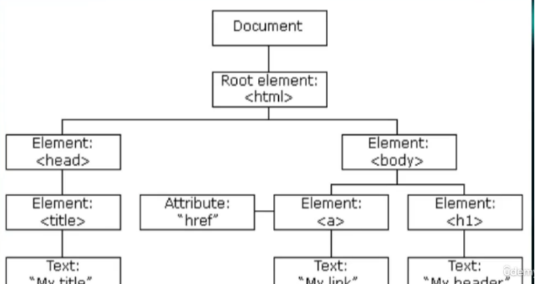

# Seção 16: JavaScript e o navegador

## 🔹 A Web e os Protocolos

Um protocolo é um conjunto de regras que define como os computadores se comunicam através de uma rede, como a internet.

Graças aos protocolos, dispositivos conseguem enviar, receber e interpretar informações corretamente.

Cada protocolo possui uma função específica dentro da comunicação na web.

### HTTP

O HTTP (`HyperText Transfer Protocol`) é o protocolo utilizado para comunicação entre navegadores e servidores web.

Ele permite:

- acessar sites;
- solicitar páginas HTML;
- carregar imagens, vídeos e arquivos;
- enviar dados para servidores.

Quando acessamos um site, o navegador faz requisições HTTP para o servidor da aplicação.

#### Exemplo

```text
https://www.site.com
```

Nesse caso, o navegador utiliza HTTP/HTTPS para carregar o conteúdo do site.

### HTTPS

O HTTPS é a versão segura do HTTP.

O “S” significa `Secure`.

Ele criptografa os dados enviados entre navegador e servidor, aumentando a segurança das informações.

É utilizado principalmente para:

- logins;
- senhas;
- pagamentos;
- dados pessoais.

### SMTP

O SMTP (`Simple Mail Transfer Protocol`) é o protocolo utilizado para envio de e-mails.

Ele é responsável por encaminhar mensagens entre servidores de e-mail.

#### Exemplo

Quando enviamos um e-mail pelo Gmail ou Outlook, o SMTP participa do envio da mensagem.

### TCP

O TCP (`Transmission Control Protocol`) é um protocolo responsável pela transferência confiável de dados na rede.

Ele garante que:

- os dados cheguem corretamente;
- os pacotes sejam entregues na ordem certa;
- informações perdidas sejam reenviadas.

O TCP é muito utilizado junto do HTTP.

### Resumo

| Protocolo | Função |
|---|---|
| HTTP | Comunicação entre navegador e servidor |
| HTTPS | Versão segura do HTTP |
| SMTP | Envio de e-mails |
| TCP | Transferência confiável de dados |

## 🔹 A Web: URL

Todo recurso acessado na internet possui uma URL.

URL significa `Uniform Resource Locator` (Localizador Uniforme de Recursos).

Ela funciona como o “endereço” de um recurso na web, permitindo que o navegador encontre páginas, imagens, arquivos, vídeos e outros conteúdos.

### Estrutura de uma URL

Uma URL normalmente é dividida em três partes principais:

```text
http://www.horadecodar.com.br/index.html
```

#### 1. Protocolo

`http`

Define a forma de comunicação utilizada entre navegador e servidor.

Exemplos:

- `http`
- `https`

#### 2. Servidor / Domínio

`www.horadecodar.com.br`

É o endereço do servidor onde o site está hospedado.

O domínio é convertido por um DNS para um endereço IP, permitindo localizar o servidor na internet.

##### Exemplo

O DNS funciona como uma “lista telefônica” da internet:

- transforma nomes como `google.com`
- em endereços IP como `142.250.190.14`

#### 3. Recurso / Arquivo

`index.html`

Representa o arquivo ou recurso que será carregado pelo navegador.

Pode ser:

- uma página HTML;
- uma imagem;
- um vídeo;
- um PDF;
- uma API, etc.

### Exemplo completo

```text
https://site.com/produtos/camisa.html
```

| Parte | Significado |
|---|---|
| `https` | protocolo |
| `site.com` | servidor/domínio |
| `/produtos/camisa.html` | recurso solicitado |

### Resumo

- URL é o endereço de um recurso na internet;
- ela identifica onde o recurso está localizado;
- é composta por protocolo, domínio e recurso;
- o navegador utiliza a URL para localizar e carregar conteúdos da web.

## 🔹 A Web: HTML

`HTML` significa `HyperText Markup Language`.

É uma linguagem de marcação responsável pela estrutura e conteúdo visual de páginas web.

Com HTML criamos:

- títulos
- parágrafos
- imagens
- listas
- tabelas
- formulários
- botões

Exemplo:

```html
<h1>Título</h1>
<p>Meu texto</p>
```

Uma tag normalmente possui abertura e fechamento:

```html
<p></p>
```

Exemplo:

```html
<p>Texto</p>
```

### Tags sem fechamento

Algumas tags não possuem fechamento:

```html

<br>
<input>
```

Essas tags são chamadas de elementos vazios.

## 🔹 A Web: Estrutura do HTML

Todo documento HTML normalmente possui duas partes principais:

```html
<html>
<head>
</head>
<body>
</body>
</html>
```

### Head

O `head` contém configurações da página.

Exemplos:

- metadados
- links CSS
- scripts
- título da página

Tags comuns:

```html
<meta>
<link>
<title>
<script>
```

Exemplo:

```html
<head>
<title>Minha página</title>
<meta charset="UTF-8">
<link rel="stylesheet" href="style.css">
</head>
```

### Body

O `body` representa a parte visual mostrada ao usuário.

Tags comuns:

```html
<p>
<h1>
<div>
<ul>
<li>
```

Exemplo:

```html
<body>
<h1>Título</h1>
<p>Texto</p>
</body>
```

## 🔹 HTML e JavaScript

Podemos utilizar JavaScript diretamente no HTML através da tag:

```html
<script>
console.log("Olá");
</script>
```

Também podemos importar arquivos externos:

```html
<script src="app.js"></script>
```

Essa é a forma mais utilizada.

Quando usamos `src`, o navegador faz uma requisição HTTP para buscar o arquivo.

Exemplo:

```html
<script src="script.js"></script>
```

### Eventos HTML

Algumas tags aceitam atributos JavaScript:

```html
<button onclick="alert('Olá')">
Clique
</button>
```

Hoje essa abordagem é menos utilizada.

Normalmente usamos eventos diretamente pelo JavaScript.

## 🔹 Estrutura HTML e DOM

Quando uma página é carregada, o navegador recebe o HTML como texto.

Esse texto é transformado em uma estrutura hierárquica.

Exemplo:

```html
<div>
    <h1>Título</h1>
    <p>Texto</p>
</div>
```

As tags ficam organizadas umas dentro das outras.

Essa estrutura é representada no JavaScript através do `DOM`.

DOM significa:

**Document Object Model**

O DOM transforma os elementos HTML em objetos manipuláveis pelo JavaScript.

### Exemplo de estrutura

```html
<body>
<div>
    <h1>Título principal</h1>
    <p>Algum texto</p>
</div>
<div>
    <h2>Lista de tarefas</h2>
    <ul>
        <li>Coisa 1</li>
        <li>Coisa 2</li>
        <li>Coisa 3</li>
    </ul>
</div>
</body>
```

Representação:

```text
html
│
├── head
│
└── body
    │
    ├── div
    │   ├── h1
    │   └── p
    │
    └── div
        ├── h2
        └── ul
            ├── li
            ├── li
            └── li
```

## 🔹 O DOM

O DOM permite alterar completamente uma página usando JavaScript.

Podemos:

### Alterar elementos

```javascript
element.innerHTML = "Novo texto";
```

### Alterar atributos

```javascript
imagem.src = "foto.png";
```

### Alterar CSS

```javascript
titulo.style.color = "red";
```

### Adicionar elementos

```javascript
document.body.appendChild(div);
```

### Remover elementos

```javascript
element.remove();
```

### Criar eventos

```javascript
botao.addEventListener(
    "click",
    function() {
        console.log("clicou");
    }
);
```

Também podemos criar:

- animações
- validações
- interações
- efeitos visuais
- atualizações dinâmicas

## 🔹 A Árvore do DOM

O DOM pode ser representado como uma árvore.

Toda página HTML forma uma estrutura hierárquica.

### Root (raiz)

A raiz da árvore é chamada de:

```javascript
document
```

Existe apenas **uma raiz**.

Ela representa todo o documento HTML.

Exemplo:

```javascript
document
```

### Nodes (nós)

Cada elemento HTML da página é chamado de **node** (nó).

Exemplo:

```html
<div>
<h1>Título</h1>
<p>Texto</p>
</div>
```

Representação:

```text
document
│
└── div
    │
    ├── h1
    │
    └── p
```

O `div`, `h1` e `p` são nodes.

### Leaf Nodes (folhas)

Os conteúdos internos dos elementos são chamados de **leaf nodes**.

Exemplo:

```html
<h1>Título principal</h1>
```

Estrutura:

```text
h1
│
└── "Título principal"
```

O texto:

```text
"Título principal"
```

é uma folha da árvore.

### Estrutura completa

```text
document
│
└── html
    │
    ├── head
    │   └── title
    │
    └── body
        │
        ├── div
        │   ├── h1
        │   │   └── "Título"
        │   │
        │   └── p
        │       └── "Texto"
        │
        └── ul
            ├── li
            ├── li
            └── li
```



*Figura: organograma/árvore hierárquica do DOM (document → Root element `<html>` → `<head>` e `<body>` → elementos e textos). Figura de tipo organograma (árvore), não fluxograma.*

### Resumo

**HTML** → estrutura da página

**DOM** → representação do HTML no JavaScript

**document** → raiz da árvore

**node** → elementos HTML

**leaf node** → conteúdos/textos internos

## 🔹 Movendo-se através do DOM

### Conceito

Podemos navegar pelos elementos do HTML utilizando o **DOM (Document Object Model)**.

O acesso normalmente começa pelo:

```javascript
document.body
```

A partir dele conseguimos percorrer os elementos filhos usando:

```javascript
childNodes
```

Depois podemos acessar propriedades específicas do elemento, como por exemplo:

```javascript
textContent
```

Fluxo da navegação:

```text
document
   ↓
body
   ↓
childNodes
   ↓
elementos filhos
   ↓
propriedades (textContent, innerHTML, etc.)
```

### Exemplo HTML

```html
<!DOCTYPE html>
<html>
<head>
<title>Título da página</title>
<meta charset="UTF-8">
</head>
<body>
<div>
<h1>Título principal</h1>
<p>Algum texto</p>
</div>
<div>
<h2>Lista de tarefas</h2>
<ul>
<li>Coisa 1</li>
<li>Coisa 2</li>
<li>Coisa 3</li>
</ul>
</div>
</body>
</html>
```

### Navegando pelo DOM

Exibir o elemento `<body>`:

```javascript
console.log(document.body);
```

Resultado:

```text
<body>...</body>
```

Exibir os filhos do body:

```javascript
console.log(document.body.childNodes);
```

Resultado aproximado:

```text
NodeList(5)
```

> `childNodes` retorna todos os nós, incluindo espaços e quebras de linha.

Acessar um elemento específico:

```javascript
console.log(document.body.childNodes[1]);
```

Resultado:

```html
<div>
    <h1>Título principal</h1>
    <p>Algum texto</p>
</div>
```

Acessando o conteúdo interno:

```javascript
console.log(
document.body
.childNodes[1]
.childNodes[1]
);
```

Resultado:

```html
<h1>Título principal</h1>
```

Obtendo apenas o texto:

```javascript
console.log(
document.body
.childNodes[1]
.childNodes[1]
.textContent
);
```

Resultado:

```text
Título principal
```

### Observações importantes

⚠️ `childNodes` considera:

- elementos HTML
- espaços
- quebras de linha
- comentários

Por isso os índices podem mudar.

Exemplo:

```javascript
childNodes[0]
```

Pode ser uma quebra de linha (`#text`) e não um elemento HTML.

Para acessar apenas elementos HTML costuma ser mais seguro usar:

```javascript
children
```

Exemplo:

```javascript
document.body.children
```

### Resumo rápido

```javascript
document.body
```

→ acessa o body

```javascript
childNodes
```

→ retorna todos os nós

```javascript
children
```

→ retorna apenas elementos HTML

```javascript
textContent
```

## 🔹 Encontrando elementos no DOM

O JavaScript permite encontrar elementos HTML de forma mais simples, sem precisar navegar manualmente pelo DOM.

Como o HTML possui **tags**, **IDs** e **classes**, podemos utilizar essas características para localizar elementos específicos da página.

Os principais métodos são:

- `getElementsByTagName()`
- `getElementById()`
- `getElementsByClassName()`
- `querySelector()`
- `querySelectorAll()`

## 🔹 Encontrando elementos por Tag

Utilizamos `getElementsByTagName()` para buscar elementos pela sua tag HTML.

Sintaxe:

```javascript
document.getElementsByTagName('nome-da-tag');
```

Exemplos:

```javascript
console.log(document.getElementsByTagName('h1'));
console.log(document.getElementsByTagName('p'));
console.log(document.getElementsByTagName('li'));
```

Tags comuns:

```html
<h1>Título</h1>
<p>Parágrafo</p>
<li>Item da lista</li>
```

Observação:

Este método retorna uma coleção de elementos encontrados.

## 🔹 Encontrando elementos por ID

Utilizamos `getElementById()` para buscar um elemento pelo ID.

Sintaxe:

```javascript
document.getElementById('algum-id');
```

Exemplos:

```javascript
console.log(
document.getElementById(
'titulo-principal'
));
```

Exemplo HTML:

```html
<h1 id="titulo-principal">
Título principal
</h1>
```

Observação:

O ID deve ser único na página.

## 🔹 Encontrando elementos por Classe

Utilizamos `getElementsByClassName()` para buscar elementos pela classe.

Sintaxe:

```javascript
document.getElementsByClassName(
'alguma-classe'
);
```

Exemplos:

```javascript
console.log(
document.getElementsByClassName(
'teste'
));

console.log(
document.getElementsByClassName(
'itens-azuis'
));

console.log(
document.getElementsByClassName(
'itens-vermelhos'
));
```

Exemplo HTML:

```html
<li class="itens-azuis">
Item 1
</li>
<li class="itens-azuis">
Item 2
</li>
<li class="itens-vermelhos">
Item 3
</li>
```

Observação:

Uma mesma classe pode ser reutilizada em vários elementos.

## 🔹 Encontrando elementos com Query Selector

O método `querySelector()` funciona utilizando seletores CSS.

Ele é muito flexível e permite buscar elementos usando:

- ID
- Classe
- Tag
- Elementos aninhados

### Buscar por ID

Usamos `#` antes do nome do ID.

```javascript
console.log(
document.querySelector(
'#algum-id'
));
```

Exemplo:

```javascript
console.log(
document.querySelector(
'#titulo-principal'
));
```

### Buscar por Classe

Usamos `.` antes do nome da classe.

```javascript
console.log(
document.querySelector(
'.teste'
));
```

Exemplo:

```javascript
console.log(
document.querySelector(
'.itens-azuis'
));
```

### Buscar por Tag

```javascript
console.log(
document.querySelector(
'h1'
));
```

## 🔹 Buscar elementos internos (aninhados)

Buscar `h1` dentro do container principal:

```javascript
console.log(
document.querySelector(
'#container-principal h1'
));
```

Buscar `h1` dentro do segundo container:

```javascript
console.log(
document.querySelector(
'#segundo-container h1'
));
```

Buscar `p` dentro de `div`:

```javascript
console.log(
document.querySelector(
'div div p'
));
```

Buscar `h2` dentro do footer:

```javascript
console.log(
document.querySelector(
'footer h2'
));
```

Buscar itens azuis dentro de uma lista:

```javascript
console.log(
document.querySelector(
'ul .itens-azuis'
));
```

**Observação:**

`querySelector()` retorna apenas o **primeiro elemento encontrado**.

Para retornar todos os elementos:

```javascript
document.querySelectorAll(
'li'
);
```

### Resumo

| Método | Busca | Retorno |
|---|---|---|
| `getElementsByTagName()` | Tag HTML | Coleção |
| `getElementById()` | ID | Elemento único |
| `getElementsByClassName()` | Classe | Coleção |
| `querySelector()` | Seletor CSS | Primeiro elemento |
| `querySelectorAll()` | Seletor CSS | Todos os elementos |

## 🔹 insertBefore()

### O que faz?

Insere um elemento antes de outro elemento já existente na página.

### Sintaxe

```javascript
elementoPai.insertBefore(novoElemento, elementoReferencia);
```

### Parâmetros

- **novoElemento**: elemento que será inserido.
- **elementoReferencia**: elemento que servirá como referência para a inserção.
- **elementoPai**: pai dos dois elementos.

### Exemplo

```javascript
let span = document.createElement("span");
let titulo = document.querySelector("h1");
let pai = titulo.parentNode;
pai.insertBefore(span, titulo);
```

### Exemplo com texto

```javascript
let novoElemento = document.createElement("p");
let texto = document.createTextNode("Algum texto");
novoElemento.appendChild(texto);
let elementoAlvo = document.querySelector("#titulo-principal");
let elementoPai = document.querySelector("#container-principal");
elementoPai.insertBefore(novoElemento, elementoAlvo);
```

📌 Resultado: o novo parágrafo será inserido antes do elemento com id `titulo-principal`.

## 🔹 appendChild()

### O que faz?

Adiciona um elemento como último filho de um elemento pai.

### Sintaxe

```javascript
elementoPai.appendChild(novoElemento);
```

### Parâmetros

- **novoElemento**: elemento que será adicionado.
- **elementoPai**: elemento que receberá o novo filho.

### Exemplo

```javascript
let p = document.createElement("p");
let titulo = document.querySelector("h1");
let pai = titulo.parentNode;
pai.appendChild(p);
```

### Exemplo com texto

```javascript
let novoElemento = document.createElement("p");
let texto = document.createTextNode("Algum texto");
novoElemento.appendChild(texto);
let paragrafo = document.querySelector("#paragrafo-principal");
let pai = paragrafo.parentNode;
pai.appendChild(novoElemento);
```

📌 Resultado: o novo parágrafo será adicionado após os elementos já existentes dentro do pai.

## 🔹 replaceChild()

### O que faz?

Substitui um elemento existente por um novo elemento.

### Sintaxe

```javascript
elementoPai.replaceChild(novoElemento, elementoAntigo);
```

### Parâmetros

- **novoElemento**: elemento que substituirá o antigo.
- **elementoAntigo**: elemento que será removido.
- **elementoPai**: pai dos dois elementos.

### Exemplo

```javascript
let newHeading = document.createElement("h1");
newHeading.textContent = "Novo texto";
let oldHeading = document.getElementById("old-heading");
let pai = oldHeading.parentNode;
pai.replaceChild(newHeading, oldHeading);
```

### Exemplo com parágrafo

```javascript
let novoElemento = document.createElement("p");
let texto = document.createTextNode("Algum texto");
novoElemento.appendChild(texto);
let heading = document.querySelector("#titulo-principal");
let paiHeading = heading.parentNode;
paiHeading.replaceChild(novoElemento, heading);
```

📌 Resultado: o elemento `#titulo-principal` será removido e substituído pelo novo parágrafo.

### Resumo Rápido

| Método | Função |
|---|---|
| `insertBefore()` | Insere um elemento antes de outro |
| `appendChild()` | Adiciona um elemento ao final do elemento pai |
| `replaceChild()` | Substitui um elemento existente por outro |

### Como lembrar?

- `insertBefore` → "Inserir antes"
- `appendChild` → "Adicionar como último filho"
- `replaceChild` → "Trocar um elemento por outro"

## 🔹 Criando Nós de Texto

### O que faz?

Cria um nó de texto puro que pode ser inserido dentro de um elemento HTML.

### Sintaxe

```javascript
let texto = document.createTextNode("Texto desejado");
elemento.appendChild(texto);
```

### Exemplo

```javascript
let texto = document.createTextNode("Este é o texto");
let p = document.getElementById("p-sem-texto");
p.appendChild(texto);
```

📌 Resultado: o texto será adicionado dentro do elemento `<p>`.

### Quando usar?

- Adicionar texto dinamicamente.
- Preencher elementos vazios.
- Inserir conteúdo gerado pelo JavaScript.

## 🔹 Criando Nós de Elemento

### O que faz?

Cria um novo elemento HTML dinamicamente através do JavaScript.

### Sintaxe

```javascript
let elemento = document.createElement("tag");
```

### Exemplo

```javascript
let span = document.createElement("span");
let el = document.querySelector("h1");
let pai = el.parentNode;
pai.insertBefore(span, el);
```

📌 Resultado: um elemento `<span>` será criado e inserido antes do `<h1>`.

### Tags comuns

```javascript
document.createElement("div");
document.createElement("p");
document.createElement("span");
document.createElement("button");
document.createElement("img");
```

### Quando usar?

- Criar elementos dinamicamente.
- Construir interfaces via JavaScript.
- Inserir conteúdo sem alterar o HTML manualmente.

## 🔹 Modificando e Lendo Atributos

### O que faz?

Permite consultar ou alterar atributos de elementos HTML.

Exemplos de atributos:

- `href`
- `src`
- `id`
- `class`
- `title`
- `alt`

### getAttribute()

#### Função

Obtém o valor de um atributo.

#### Sintaxe

```javascript
elemento.getAttribute("atributo");
```

#### Exemplo

```javascript
let url = document.getElementById("link");
console.log(url.getAttribute("href"));
```

📌 Resultado: exibe no console o valor atual do atributo `href`.

### setAttribute()

#### Função

Adiciona ou altera o valor de um atributo.

#### Sintaxe

```javascript
elemento.setAttribute("atributo", "novoValor");
```

#### Exemplo

```javascript
let url = document.getElementById("link");
url.setAttribute("href", "https://www.horadecodar.com.br");
console.log(url.getAttribute("href"));
```

📌 Resultado: o link passa a apontar para o novo endereço informado.

### Resumo Rápido

| Método | Função |
|---|---|
| `createTextNode()` | Cria um nó de texto |
| `createElement()` | Cria um novo elemento HTML |
| `getAttribute()` | Obtém o valor de um atributo |
| `setAttribute()` | Altera ou cria um atributo |

### Como lembrar?

- `createTextNode` → Cria texto.
- `createElement` → Cria elementos HTML.
- `getAttribute` → Lê atributos.
- `setAttribute` → Altera atributos.

## 🔹 Verificando Altura e Largura de um Elemento

### O que faz?

Permite obter as dimensões de um elemento HTML através do JavaScript.

### offsetWidth e offsetHeight

### Função

Retornam a largura e a altura total do elemento, incluindo as bordas.

### Exemplo

```javascript
let elemento = document.querySelector('#titulo-principal');
console.log('Largura: ' + elemento.offsetWidth);
console.log('Altura: ' + elemento.offsetHeight);
```

📌 Considera:

- Conteúdo
- Padding
- Bordas

### clientWidth e clientHeight

### Função

Retornam a largura e a altura do elemento sem considerar as bordas.

### Exemplo

```javascript
let elemento = document.querySelector('#titulo-principal');
console.log('Largura: ' + elemento.clientWidth);
console.log('Altura: ' + elemento.clientHeight);
```

📌 Considera:

- Conteúdo
- Padding

❌ Não considera:

- Bordas

### Comparação

| Propriedade | Considera Borda? |
|---|---|
| offsetWidth | ✅ Sim |
| offsetHeight | ✅ Sim |
| clientWidth | ❌ Não |
| clientHeight | ❌ Não |

## 🔹 Posição do Elemento na Tela

### O que faz?

Permite verificar a posição de um elemento dentro da janela do navegador.

### Método

```javascript
elemento.getBoundingClientRect();
```

### Exemplo

```javascript
let elemento = document.getElementById('titulo');
console.log(elemento.getBoundingClientRect());
```

Retorna informações como:

- top
- left
- right
- bottom
- width
- height

### Exemplo de retorno

```javascript
{
  top: 100,
  left: 50,
  right: 300,
  bottom: 150,
  width: 250,
  height: 50
}
```

📌 Muito utilizado para:

- Scroll infinito
- Animações
- Elementos visíveis na tela
- Drag and Drop

## 🔹 Estilizando Elementos com JavaScript

### O que faz?

Permite alterar estilos CSS diretamente pelo JavaScript.

Através da propriedade

```javascript
elemento.style
```

### Exemplo

```javascript
let p = document.getElementById('algum-p');
console.log(p.style);
p.style.color = 'red';
```

### Alterando várias propriedades

```javascript
let p = document.getElementById('algum-p');
p.style.color = 'red';
p.style.backgroundColor = 'yellow';
p.style.fontSize = '20px';
```

📌 Importante:

O JavaScript adiciona estilos inline diretamente na tag HTML.

Exemplo:

```html
<p style="color: red;">Texto</p>
```

Por isso, geralmente esses estilos têm prioridade sobre regras CSS externas.

## 🔹 Selecionando Vários Elementos com querySelectorAll()

### O que faz?

Seleciona todos os elementos que correspondem a um seletor CSS.

### Sintaxe

```javascript
document.querySelectorAll('seletor');
```

### Exemplo

```javascript
let todosPs = document.querySelectorAll('p');
console.log(todosPs);
console.log(todosPs.length);
```

📌 Resultado:

Retorna uma NodeList contendo todos os elementos encontrados.

### Selecionando por Classe

```javascript
let cards = document.querySelectorAll('.card');
```

### Selecionando por ID

```javascript
let titulo = document.querySelectorAll('#titulo');
```

### Percorrendo os Elementos

```javascript
let todosPs = document.querySelectorAll('p');
todosPs.forEach((p) => {
    console.log(p.textContent);
});
```

📌 Muito útil para aplicar alterações em vários elementos ao mesmo tempo.

### Resumo Rápido

| Método/Propriedade | Função |
|---|---|
| offsetWidth | Largura considerando bordas |
| offsetHeight | Altura considerando bordas |
| clientWidth | Largura sem bordas |
| clientHeight | Altura sem bordas |
| getBoundingClientRect() | Obtém posição e dimensões do elemento |
| style | Altera CSS via JavaScript |
| querySelectorAll() | Seleciona vários elementos |
| length | Retorna a quantidade de elementos encontrados |

### Como lembrar?

- `offset` → mede incluindo bordas.
- `client` → mede sem bordas.
- `getBoundingClientRect` → mostra onde o elemento está na tela.
- `style` → altera CSS.
- `querySelectorAll` → busca vários elementos.
