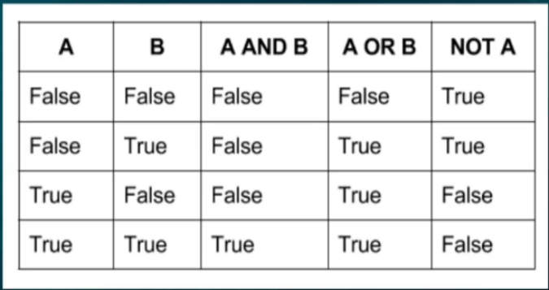

# Seção 2: Tipos de dado e operadores lógicos

## 📚 Tipos de Dados no JavaScript

### 📌 O que são tipos de dados?

Tipo de dado é a classificação de um valor.

Exemplos de valores:

```javascript
13
"Olá"
true
```

### 🧩 Tipos de dados primitivos no JavaScript

- **Number**
- **String**
- **Boolean**
- **Empty values**
  - `null`
  - `undefined`

### 🔢 Number

Representa números inteiros, negativos e decimais.

```javascript
console.log(typeof 13);// number
console.log(typeof 1.8);// number
console.log(typeof -5);// number
```

### ➕ Aritmética com Numbers

Operações matemáticas geram um novo `number`.

```javascript
console.log(2 + 2);
console.log(2 * 4 - 3);
console.log(8 / 4);
console.log(5 + (2 * 4));
```

#### Operadores Aritméticos

| Operador | Função |
|---|---|
| + | Soma |
| - | Subtração |
| * | Multiplicação |
| / | Divisão |
| % | Resto da divisão |

```javascript
console.log(typeof (2+2));// number
```

### ⚠️ Special Numbers

São considerados `number`, mas têm comportamento especial:

- `Infinity`
- `-Infinity`
- `NaN` (Not a Number)

```javascript
console.log(Infinity);
console.log(-Infinity);
console.log(NaN);
```

```javascript
console.log(typeof Infinity);// number
console.log(typeof NaN);// number
```

### 📝 String

String representa **texto**.

Pode ser criada com:

- Aspas simples `'`
- Aspas duplas `"`
- Template literals `` ` ``

```javascript
console.log(typeof 'Texto');// string
console.log(typeof "Texto");// string
console.log(typeof `Texto`);// string
```

### 🔎 Detalhes importantes sobre String

#### 🔹 Quebra de linha

```javascript
console.log("Primeira linha\nSegunda linha");
```

#### 🔹 Uso de aspas dentro da string

```javascript
console.log("Meu nome é 'Matheus'");
console.log('O nome dela é "Roberta"');
```

#### 🔹 Template Literals (interpolação)

Permite inserir valores dentro da string usando `${}`:

```javascript
console.log(`A soma de 2 + 2 é ${2+2}`);
console.log(`A multiplicação de 5 por 3 é ${5*3}`);
```

#### 🔹 Concatenação

Juntar strings com `+`:

```javascript
console.log("salada"+" de "+"fruta");
console.log("O "+"meu "+"nome "+"é "+"Matheus.");
```

### 🔘 Boolean

Representa valores lógicos.

Apenas dois valores possíveis:

- `true`
- `false`

Muito usado em comparações:

```javascript
console.log(5 > 2);// true
console.log(3 > 10);// false
```

```javascript
console.log(typeof true);// boolean
console.log(typeof (10 > 2));// boolean
```

### 📌 Resumo rápido

| Tipo | Exemplo | typeof |
|---|---|---|
| Number | 10, 3.5 | number |
| String | "Olá" | string |
| Boolean | true | boolean |
| Null | null | object (peculiaridade do JS) |
| Undefined | undefined | undefined |

### 🔘 Booleans: Comparações no JavaScript

Operadores de comparação retornam sempre um **boolean**:

- `true`
- `false`

### 📌 Operadores de Comparação

| Operador | Significado |
|---|---|
| `>` | Maior que |
| `<` | Menor que |
| `>=` | Maior ou igual |
| `<=` | Menor ou igual |
| `==` | Igual (com conversão de tipo) |
| `!=` | Diferente |
| `===` | Idêntico (valor e tipo) |
| `!==` | Não idêntico |

### ✅ Exemplos

```javascript
console.log(1 > 2);// false
console.log(5 < 10);// true
console.log(3 >= 3);// true
console.log(5 <= 4);// false
console.log(5 == 4);// false
console.log('Matheus'!='Matheus');// false
console.log(4 == 4);// true
```

### ⚠️ Atenção: `==` vs `===`

Aqui está o ponto importante 👇

```javascript
console.log(3 == '3');// true
```

🔎 Isso retorna **true**, porque o `==` faz conversão automática de tipo (coerção).

Já o operador `===` não converte tipo:

```javascript
console.log(3==='3');// false
```

Porque:

- `3` é number
- `'3'` é string

Tipos diferentes → false

### 🧠 Regra de ouro

👉 Sempre prefira usar `===` em vez de `==`

Evita comportamentos inesperados.

### 📌 Resumo rápido

- `==` → compara valor (converte tipo)
- `===` → compara valor e tipo
- Operações de comparação sempre retornam `boolean`

---

## JavaScript – Booleans e Operadores

### 🔹 1. Booleans: Operadores Lógicos

Operadores lógicos retornam sempre um **valor booleano** (`true` ou `false`).

#### ✅ Operadores

| Operador | Nome | Regra |
|---|---|---|
| `&&` | AND | Só é `true` se **os dois lados** forem `true` |
| `\|\|` | OR | Basta que **um dos lados** seja `true` |
| `!` | NOT | Inverte o valor (`true` → `false`) |

#### 🔎 Tabela da Verdade



*Figura: print da tabela verdade (AND, OR e NOT) como aparece no PDF original.*

Tabela-verdade dos operadores lógicos (`AND`, `OR` e `NOT`):

| A | B | A AND B | A OR B | NOT A |
|---|---|---|---|---|
| False | False | False | False | True |
| False | True | False | True | True |
| True | False | False | True | False |
| True | True | True | True | False |

#### 💻 Exemplos

```javascript
console.log(true && true); // true
console.log(true && false); // false
console.log(false || false); // false
console.log(!true); // false
```

#### 📌 Exemplos Práticos

```javascript
console.log(5 > 3 && 3 == 2); // false
console.log(5 > 3 || 3 == 1); // true

console.log(3 == 3 && "Matheus" == "Matheus"); // true
console.log("Felipe" == "João" || false); // false

console.log(!(!(true && true))); // true
```

### 🔹 2. Operador Ternário

Permite fazer uma condição em **uma única linha**.

#### 📌 Estrutura

```javascript
condição ? valor_se_true : valor_se_false;
```

#### 💻 Exemplos

```javascript
console.log(true ? 1 : 2);
console.log(false ? 'falso' : 'verdadeiro');
```

#### 📌 Exemplos Práticos

```javascript
console.log(5 > 2 ? 'É sim' : 'É não');
console.log(false ? 5 : 4);
console.log("Matheus" == "Matheus" ? "Olá, Matheus!" : "Não é o Matheus!");
```

⚠️ **Observação:** pode deixar o código menos legível se usado em excesso.

### 🔹 3. Empty Values

Existem dois valores especiais no JavaScript:

| Palavra | Significado |
|---|---|
| `null` | Valor intencionalmente vazio |
| `undefined` | Valor não definido |

📌 Sempre que você encontrar esses valores, significa que **não há valor definido**.

#### 💻 Exemplos

```javascript
console.log(null); // null
console.log(undefined); // undefined
```

### 🔹 4. Conversão de Tipo Automática (Type Coercion)

O JavaScript pode converter tipos automaticamente durante operações.

#### 💻 Exemplos

```javascript
console.log(5 * null); // 0
console.log("5" - 3); // 2
console.log("5" + 1); // 51
console.log("dois" * "tres"); // NaN
```

#### 📌 Exemplos Práticos

```javascript
console.log("123" + 4); // "1234"
console.log("30" - 20); // 10
console.log("ausd" * 3); // NaN
```

#### 🔎 Verificando o Tipo

```javascript
console.log(typeof ("123" + 4)); // string
console.log(typeof ("30" - 20)); // number
console.log(typeof ("ausd" * 3)); // number (NaN é do tipo number)
```

📌 **Observação importante:** `NaN` significa *Not a Number*, mas o tipo dele é `number`.
