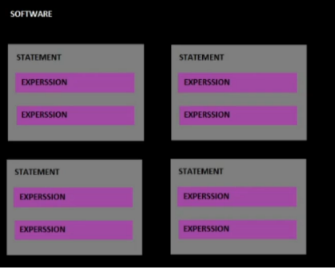
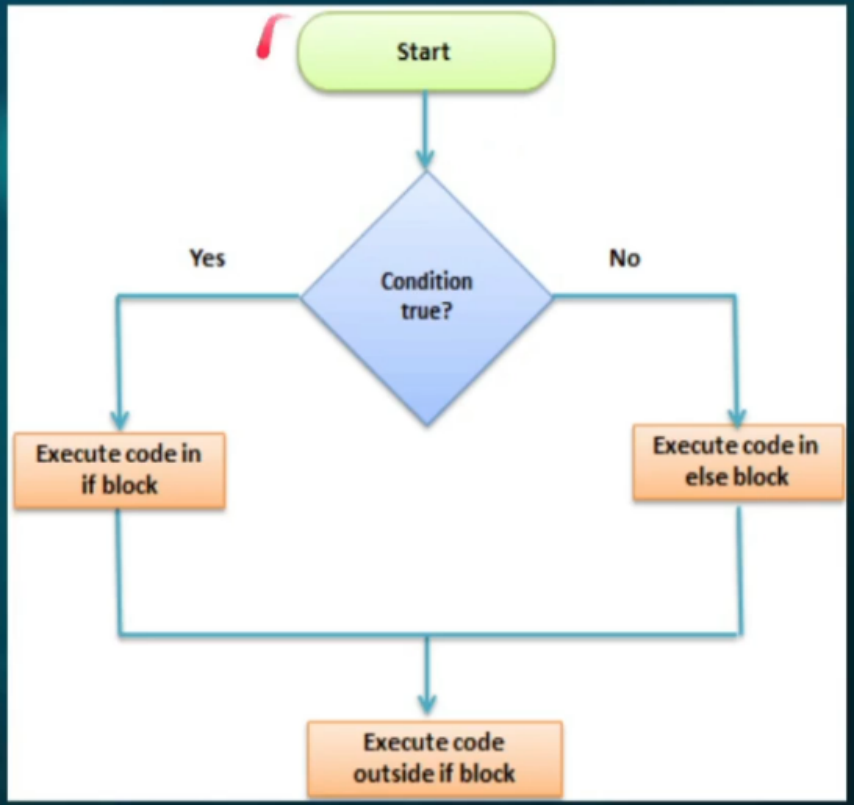
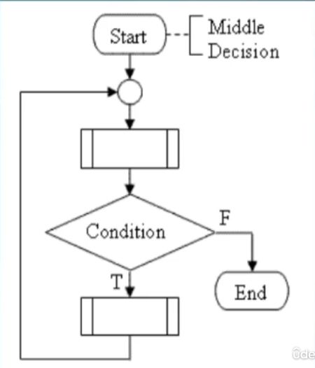

# Seção 4: Estruturas de Programação

## O que é um programa (software)?

Um **programa** ou **software** é um conjunto de **declarações (statements)** que dizem ao computador o que ele deve fazer.

### Statements (Declarações)

**Statements** são instruções que guiam o funcionamento do software.

Eles determinam **as ações que o programa executa** para alcançar um objetivo.

Exemplo:

```javascript
console.log(1 > 2);
```

Nesse caso, o programa executa a instrução de mostrar algo no console.

### Expressions (Expressões)

**Expressions** são fragmentos de código que **produzem um valor**.

Elas são usadas dentro dos statements para fornecer os valores necessários para a execução das instruções.

Exemplos:

```javascript
1 > 2
```

Essa expressão produz o valor:

```javascript
false
```

Outro exemplo:

```javascript
'batata'
```

Essa expressão produz uma **string** com o valor `"batata"`.

### Relação entre Statements e Expressions

- **Expressions** geram valores.
- **Statements** usam esses valores para executar ações.

Ou seja:

**Expressions fornecem os dados, e Statements executam as ações.**

### Exemplo prático

```javascript
console.log(1 > 2);
```

- `console.log()` → é um **statement**
- `1 > 2` → é uma **expression**
- O resultado da expressão (`false`) é usado pelo statement.

### Conclusão

Para criar um software, precisamos combinar:

- **Statements** → instruções que controlam o programa
- **Expressions** → valores usados nessas instruções

Até agora vimos esses conceitos de forma simples, mas **a construção de um software envolve a combinação desses dois elementos**.



*Figura (página 3): diagrama de blocos hierárquico (não é fluxograma) ilustrando um software formado por statements, cada um contendo expressions.*

## Como salvar valores na memória

Em programação, salvamos valores na memória usando **variáveis**.

Criar uma variável é um **statement (declaração)**.

Exemplo:

```javascript
let laranjas = 5;
```

Aqui estamos criando uma variável chamada **laranjas** e salvando o valor **5** nela.

Depois podemos usar esse valor em **expressões**.

Exemplos:

```javascript
console.log(laranjas * laranjas);
console.log(`Tem ${laranjas} na sexta`);
```

No primeiro exemplo, multiplicamos o valor da variável.

No segundo, usamos **template string** para inserir o valor dentro do texto.

## Alterando o valor de uma variável

Também podemos **alterar o valor salvo em uma variável**.

Exemplo:

```javascript
laranjas = laranjas + 1;
console.log(laranjas);
```

Aqui estamos pegando o valor atual de `laranjas`, somando `1`, e salvando novamente.

## Criando várias variáveis na mesma declaração

Podemos declarar **várias variáveis em uma única linha**:

```javascript
let quadrado = 4, triangulo = 3, retangulo = 4;

console.log(quadrado * (triangulo + retangulo));
```

## Outras maneiras de salvar valores

Além de **let**, também podemos criar variáveis usando **var** e **const**.

Exemplo:

```javascript
var nome = 'Pedro';
console.log(nome);

const sobrenome = 'Soares';
console.log(sobrenome);
```

### Diferenças básicas

**var**

- Forma mais antiga de declarar variáveis no JavaScript.
- Hoje em dia quase não é utilizada.

**let**

- Forma moderna de criar variáveis.
- Permite alterar o valor depois.

**const**

- Vem de **constante**.
- O valor **não pode ser alterado depois de definido**.

Exemplo:

```javascript
const idade = 20;
```

Mais adiante no curso, as diferenças entre **var, let e const** serão explicadas com mais detalhes.

## Convenções no nome das variáveis

Existem algumas regras para nomear variáveis no JavaScript.

### 1️⃣ Não pode começar com número

❌ Errado:

```javascript
let 2teste;
```

### 2️⃣ Pode terminar com número

✅ Correto:

```javascript
let teste9 = 'testando';
```

### 3️⃣ Pode usar `$` ou `_`

Exemplos:

```javascript
let $nome;
let _nome;
```

### 4️⃣ Não pode usar caracteres especiais

❌ Errado:

```javascript
let @teste;
```

Também não pode usar pontuação ou espaços.

### 5️⃣ Pode começar com letra maiúscula

```javascript
let Nome = 'Matheus';
```

Porém, na maioria dos casos em JavaScript usamos **camelCase**:

```javascript
let nomeCompleto = 'Matheus Silva';
```

**✅ Resumo rápido**

- Variáveis guardam valores na memória.
- Podem ser criadas com **let, var ou const**.
- **let** → pode mudar o valor.
- **const** → valor fixo.
- **var** → forma antiga.

## 🔹 Nomes de Variáveis Reservados

Em **JavaScript**, existem algumas palavras que **não podem ser usadas como nome de variáveis**, pois são **palavras reservadas da linguagem**.

Essas palavras fazem parte da **estrutura do próprio JavaScript**.

### Exemplos de palavras reservadas

```javascript
break
case
catch
class
const
continue
debugger
default
delete
do
else
enum
export
extends
false
finally
for
function
if
implements
import
interface
in
instanceof
let
new
package
private
protected
public
return
static
super
switch
this
throw
true
try
typeof
var
void
while
with
yield
```

### ❌ Exemplo inválido

```javascript
let break = "parar";
```

Isso gera erro porque **break é uma palavra reservada**.

### ✅ Exemplo válido

Podemos usar a palavra reservada **junto com outro nome**:

```javascript
let breakMatheus = 1;
```

Ou:

```javascript
let breakTime = 10;
```

## 🔹 Como Funciona o Ambiente JavaScript

Quando **qualquer programa é iniciado**, um **ambiente de execução** é criado.

Esse ambiente **não começa vazio**.

Ele já possui:

- Funções nativas da linguagem
- Objetos do JavaScript
- Recursos do ambiente onde está rodando

### O que são funções?

Funções são **blocos de código reutilizáveis** que executam alguma ação.

Elas podem:

- Executar uma tarefa
- Retornar um valor

### Ambiente no contexto do curso

Neste curso, o **ambiente JavaScript** pode ser entendido como **o navegador**.

Exemplos de navegadores:

- Chrome
- Edge
- Firefox

Eles fornecem funções como:

- `alert()`
- `prompt()`
- `console.log()`

## 🔹 Estrutura de uma Função

Funções **precisam ser chamadas para serem executadas**.

Você também pode ouvir termos como:

- Executar uma função
- Chamar uma função
- Invocar uma função

Todas significam a mesma coisa.

### Chamando uma função

Chamamos uma função usando:

```javascript
nomeDaFuncao();
```

Exemplo:

```javascript
nomeDaFuncao();
```

### Funções com parâmetros

Algumas funções recebem **parâmetros**.

Parâmetros são **valores enviados para dentro da função**.

Eles podem **alterar o resultado da função**.

Exemplo:

```javascript
nomeDaFuncao(parametro1,parametro2);
```

## 🔹 Função Built-in: `prompt()`

A função `prompt()` é utilizada para **receber uma entrada do usuário**.

Ela **abre uma caixa de texto no navegador** e retorna o valor digitado.

Esse valor pode ser **armazenado em uma variável**.

### Exemplo

```javascript
let idade = prompt("Qual a sua idade?");

console.log(idade);
```

Outro exemplo:

```javascript
let nome = prompt("Qual o seu nome?");

console.log(`O seu nome é ${nome}`);
```

**⚠️ Observação:**

Essa função **não é muito utilizada em aplicações modernas**, mas é **bastante usada para fins didáticos**.

## 🔹 Função Built-in: `alert()`

A função `alert()` **exibe uma mensagem na tela do usuário**.

Ela **abre uma janela de aviso no navegador**.

### Exemplo

```javascript
alert("Veja esta mensagem!");
```

⚠️ Assim como `prompt()`, essa função **não é muito utilizada em aplicações modernas**, sendo mais comum em **exemplos de aprendizado**.

## 🔹 Função Built-in: `Math`

O objeto `Math` possui diversas funções matemáticas prontas.

Ele é muito utilizado para:

- cálculos
- comparações de números
- arredondamentos

### 📌 Encontrar o maior número

```javascript
let maior = Math.max(6,12,28,55,8);

console.log(maior);
```

Resultado:

```javascript
55
```

### 📌 Encontrar o menor número

```javascript
let menor = Math.min(6,12,28,55,8);

console.log(menor);
```

Resultado:

```javascript
6
```

### 📌 Arredondar número

```javascript
let arredondar = Math.round(5.2934723);

console.log(arredondar);
```

Resultado:

```javascript
5
```

### 📌 Arredondar para cima

```javascript
let arredondarParaCima = Math.ceil(5.2934723);

console.log(arredondarParaCima);
```

Resultado:

```javascript
6
```

## 🖥️ Função Built-in: `console.log()`

A função `console.log()` é uma função **nativa (built-in)** do JavaScript usada para **exibir mensagens no console** do navegador ou do ambiente de execução.

Ela recebe um **argumento**, que é o valor ou mensagem que queremos mostrar na tela.

É muito utilizada para:

- Testar códigos
- Verificar valores de variáveis
- Depurar (debugar) o programa

### Exemplo

```javascript
console.log("Exibindo esta mensagem!");
```

Nesse exemplo, a mensagem `"Exibindo esta mensagem!"` será exibida no console.

📌 Mais adiante no curso veremos **como criar nossas próprias funções**.

## 🔀 O que são Estruturas de Controle?

Por padrão, um programa em JavaScript é executado **de cima para baixo**, linha por linha.

As **estruturas de controle** permitem **alterar o fluxo de execução do programa**, fazendo com que determinadas partes do código sejam executadas **dependendo de certas condições**.

Ou seja, o caminho que o programa vai seguir depende dos **valores das expressões e instruções (statements)**.

Com isso, o programa pode:

- Tomar decisões
- Repetir ações
- Executar blocos específicos de código

📌 Exemplos de estruturas de controle que veremos:

- `if / else`
- `switch`
- `for`
- `while`



*Figura (página 14): fluxograma da estrutura condicional if / else.*

## 🔎 Estrutura Condicional: `if`

A estrutura `if` é usada quando queremos que **um bloco de código seja executado somente se uma condição for verdadeira**.

Ou seja, o programa executa o código **SE a condição for atendida**.

A condição dentro do `if` precisa retornar um **valor booleano**:

- `true` → executa o bloco de código
- `false` → ignora o bloco

### Exemplo

```javascript
let idade = 19;

if (idade > 18) {
    console.log("Pode entrar");
}
```

📌 Nesse exemplo:

- A condição é `idade > 18`
- Como `19 > 18` é **true**, o código dentro do `if` será executado.

## 🔁 Estrutura Condicional: `else`

O `else` é usado junto com o `if` para **executar um bloco de código quando a condição do `if` for falsa**.

Ou seja:

- Se a condição do `if` for **true** → executa o `if`
- Se a condição do `if` for **false** → executa o `else`

### Exemplo

```javascript
let nome = "Pedro";

if (nome == "João") {
    console.log("Seu nome é João");
} else {
    console.log("Seu nome não é João");
}
```

📌 Nesse exemplo:

- A condição verifica se `nome` é igual a `"João"`
- Como o valor é `"Pedro"`, a condição é **false**
- Portanto, o bloco `else` será executado.

## 🔀 Estrutura Condicional: `else if`

Podemos adicionar mais condições a um `if` usando `else if`.

Isso permite que o programa **verifique várias condições em sequência** antes de executar um `else`.

O funcionamento é:

1. O programa verifica o `if`
2. Se for **false**, ele verifica o primeiro `else if`
3. Se ainda for **false**, verifica o próximo `else if`
4. Se nenhuma condição for verdadeira, o `else` será executado

📌 O `else` é opcional.

### Exemplo

```javascript
let a = 5;
let b = 3;

if (a + b == 3) {
    console.log('O resultado é 3');
} else if (a == 4) {
    console.log('O valor de a é 4');
} else if (b == 3) {
    console.log('O valor de b é 3');
} else {
    console.log('Nenhuma das condições acima!');
}
```

📌 Nesse exemplo:

- `a + b == 3` → **false**
- `a == 4` → **false**
- `b == 3` → **true**

Assim, será exibido no console:

```
O valor de b é 3
```

Quando uma condição é atendida, **as próximas não são mais verificadas**.

## 🔁 O que são Estruturas de Repetição?

As **estruturas de repetição** são usadas quando queremos **executar uma ação várias vezes automaticamente**.

Em vez de repetir o mesmo código várias vezes manualmente, usamos um **statement (estrutura)** que executa o código repetidamente **até que uma condição seja atingida**.

Essas estruturas também são chamadas de **loops**.

📌 Com loops podemos:

- Repetir ações automaticamente
- Percorrer listas ou dados
- Executar código até que uma condição seja satisfeita

### Exemplos de estruturas de repetição em JavaScript

- `for`
- `while`
- `do...while`

Essas estruturas serão usadas quando precisarmos **executar o mesmo bloco de código várias vezes**.



*Figura (página 17): fluxograma genérico de estrutura de repetição (loop), com decisão de condição (T/F).*

## 🔁 Estruturas de Repetição

Estruturas de repetição permitem **executar um bloco de código várias vezes**, até que uma determinada **condição seja atingida**.

Isso evita repetir o mesmo código manualmente várias vezes.

As principais estruturas de repetição em JavaScript são:

- `while`
- `do...while`
- `for`

## 🔁 Estrutura de repetição: `while`

O `while` executa um bloco de código **enquanto uma condição for verdadeira**.

⚠️ É importante garantir que o loop tenha um **fim**, caso contrário pode ocorrer um **loop infinito**.

### Exemplo

```javascript
let x = 10

while(x > 0) {
    console.log(x);
    x = x - 1;
}
```

📌 Nesse exemplo:

- `x` começa em **10**
- A cada repetição `x` diminui **1**
- O loop continua enquanto `x > 0`

Saída no console:

```
10
9
8
7
6
5
4
3
2
1
```

## 🔁 Estrutura de repetição: `do...while`

O `do...while` é parecido com o `while`, porém possui uma diferença importante:

👉 **o bloco de código executa pelo menos uma vez**, mesmo que a condição seja falsa.

Essa estrutura **não é muito utilizada** no dia a dia.

### Exemplo

```javascript
let y = 0;

do {
    console.log(y);
    y = y + 1;
} while(y < 5);
```

📌 Nesse exemplo:

- O código executa primeiro
- Depois verifica a condição `y < 5`

Saída:

```
0
1
2
3
4
```

## 🔁 Estrutura de repetição: `for`

O `for` é uma das estruturas de repetição **mais utilizadas em JavaScript**.

Ela é muito usada quando **sabemos quantas vezes o loop deve executar**.

A estrutura do `for` possui três partes:

1️⃣ Inicialização

2️⃣ Condição

3️⃣ Incremento

### Exemplo

```javascript
for(let numero = 2; numero < 100; numero = numero * 2) {
    console.log("O número é: " + numero);
}
```

📌 Nesse exemplo:

- `numero` começa em **2**
- A cada repetição ele é **multiplicado por 2**
- O loop continua enquanto `numero < 100`

Saída:

```
2
4
8
16
32
64
```

## 📌 Precisamos falar sobre Indentação

A **indentação** serve para **organizar o código e deixá-lo mais legível**.

Ela é feita adicionando **espaços ou tabulações** no início das linhas dentro de blocos de código.

📌 Não existe uma regra rígida, mas normalmente:

- Cada bloco `{ }` aumenta um nível de indentação

⚠️ A indentação **não afeta a execução do código**, mas ajuda muito na leitura e manutenção.

Programadores agradecem quando o código está bem indentado.

### Exemplo

```javascript
let x = 2;
let y = 0;

if (x > 2) {
    y = x + 2;
    if (y == 4) {
        console.log('Y é 4');
    }
}
```

## ⛔ Forçando a saída de um loop: `break`

Às vezes precisamos **interromper um loop antes que ele termine naturalmente**.

Para isso usamos a palavra-chave `break`.

Quando o `break` é executado, o loop **é encerrado imediatamente**.

### Exemplo

```javascript
for(let i = 5; i < 20; i = i + 1) {
    if (i % 10 == 0) {
        console.log('Saiu do loop');
        break;
    }
    console.log('Prosseguindo o loop');
}
```

📌 Nesse exemplo:

- Quando `i` for **divisível por 10**
- O loop será interrompido.

## 📌 Outro exemplo com `break`

```javascript
let nome = "Kemilly";

    // Início (let i = 0)| Condição (i < 10)| Incremento (i = i + 1)
for(let i = 0; i < 10; i = i + 1) {
    if (i == 3) {
        nome = "Joana";
    }
    if (i == 5 && nome == "Joana") {
        console.log("O nome é Joana, pode parar");
        break;
    }
    console.log(i);
}
```

📌 O que acontece nesse código:

1️⃣ `i` começa em **0**

2️⃣ Quando `i` chega em **3**, o nome muda para `"Joana"`

3️⃣ Quando `i` chega em **5** e o nome é `"Joana"`, o loop **para com `break`**

💡 **Dica de programador (vale muito para suas anotações)**

Use:

- `for` → quando você **sabe quantas repetições quer**
- `while` → quando depende de **uma condição**
- `do...while` → raramente usado

## ⏭️ Pulando uma execução do loop: `continue`

Em alguns casos, dependendo da lógica do programa, podemos querer **pular uma parte da execução do loop** e seguir diretamente para a **próxima repetição**.

Para isso usamos a palavra-chave `continue`.

Quando o `continue` é executado:

- o restante do código dentro do loop **não é executado**
- o loop **vai imediatamente para a próxima repetição**

### Exemplo

```javascript
let x = 0;

while(x < 11) {
    x = x + 1;
    if (x % 2 == 0) {
        continue;
    }
    console.log(x);
    x = x + 1;
}
```

📌 O que acontece nesse código:

- `x` começa em **0**
- O loop roda enquanto `x < 11`
- Se `x` for **par** (`x % 2 == 0`), o `continue` faz o loop **pular o resto do código**

Assim, apenas alguns valores são exibidos no console.

## ➕ Incrementando variáveis de forma mais simples

Em JavaScript existem **formas mais curtas de incrementar variáveis**.

Em vez de escrever:

```javascript
x = x + 1
```

Podemos usar:

```javascript
x += 1
```

Ou ainda a forma mais comum:

```javascript
x++
```

Todos fazem a mesma coisa: **somar 1 ao valor atual da variável**.

### Exemplo usando `+=`

```javascript
for(let numero = 0; numero < 10; numero += 1) {
    console.log("O número é: " + numero);
}
```

📌 Nesse exemplo:

- `numero` começa em **0**
- A cada repetição ele aumenta **1**
- O loop continua enquanto `numero < 10`

Saída no console:

```
O número é: 0
O número é: 1
O número é: 2
...
O número é: 9
```

💡 **Resumo rápido para suas anotações**

`continue` → **pula a execução atual do loop** e vai para a próxima repetição

Formas de incrementar variável:

```javascript
x = x + 1
x += 1
x++
```

Todas aumentam **1 unidade** no valor da variável.

## 🔀 Estrutura Condicional: `switch`

O `switch` é utilizado quando precisamos **comparar uma mesma variável com vários valores diferentes**.

Ele pode substituir vários `if` e `else if`, deixando o código **mais organizado em alguns casos**.

O `switch` funciona comparando um valor com vários `case`.

Quando encontra um valor correspondente, o código daquele `case` é executado.

Para **encerrar um case**, usamos a palavra `break`.

Se nenhum valor corresponder, podemos usar o `default`, que funciona como um `else`.

⚠️ **Observação:**

Muitos programadores preferem utilizar **vários `if` e `else if`**, dependendo da situação.

### 📌 Estrutura do `switch`

```javascript
switch (variavel) {
case valor1:
// código
break;

case valor2:
// código
break;
default:
// código executado se nenhum case for verdadeiro
}
```

### 📌 Exemplo

```javascript
let fruta = "maçã";

switch (fruta) {
case "banana":
console.log("Você escolheu banana");
break;

case "maçã":
console.log("Você escolheu maçã");
break;

case "laranja":
console.log("Você escolheu laranja");
break;

default:
console.log("Fruta não encontrada");
}
```

📌 Nesse exemplo:

- O valor da variável `fruta` é `"maçã"`
- O `switch` encontra o `case "maçã"`
- Então o console exibirá:

```
Você escolheu maçã
```

### ⚠️ Importante lembrar

Se não colocarmos `break`, o JavaScript continuará executando os próximos `case`.

Exemplo:

```javascript
case "banana":
console.log("Banana");
```

Sem `break`, o código pode **executar vários cases seguidos**.

💡 **Resumo rápido para suas anotações**

`switch` → usado para comparar **uma variável com vários valores**

Elementos principais:

- `case` → condição de comparação
- `break` → encerra o case
- `default` → executa se nenhum case for verdadeiro

Exemplo:

```javascript
switch(nome) {
    case "João":
        console.log("O seu nome é João");
        break;
    case "Marcos":
        console.log("O seu nome é Marcos");
        break;
    default:
        console.log("O seu nome não é João nem Marcos!");
        break;
}
```

## 🏷️ Declaração de Variáveis (Boas práticas de nomes)

Quando criamos variáveis em JavaScript, é importante escolher **nomes claros e fáceis de ler**.

Existem várias formas de escrever nomes de variáveis, mas algumas são **mais utilizadas e recomendadas**.

### Exemplos

```javascript
let carrovermelhogrande;// difícil de ler
let carro_Vermelho_Grande;
let CarroVermelhoGrande;
let carroVermelhoGrande;// forma mais utilizada (camelCase)
```

📌 A forma mais comum em JavaScript é o **camelCase**, onde:

- a primeira palavra começa com **letra minúscula**
- as próximas palavras começam com **letra maiúscula**

Exemplo:

```javascript
let nomeCompleto;
let idadeUsuario;
let numeroDePedidos;
```

Isso deixa o código **mais legível e organizado**.

## 💬 Comentários no JavaScript

Comentários são usados para **explicar o que o código está fazendo**.

Eles também podem ser usados para:

- documentar o código
- facilitar a leitura para outros programadores
- **desativar temporariamente** partes do código para testes

📌 **Importante:**

Comentários são **ignorados pelo interpretador do JavaScript**, ou seja, **não afetam a execução do programa**.

## 📝 Comentário de uma linha

Usamos `//` para comentários de apenas uma linha.

```javascript
// Comentário de uma linha
let nome = "Kemilly";
```

## 📝 Comentário de várias linhas

Usamos `/* */` para comentários maiores.

```javascript
/*
Comentário
de várias
linhas
*/
```

💡 **Dica útil para programadores**

Muitos desenvolvedores usam comentários para explicar **partes complexas do código**, mas evitam comentar coisas muito óbvias.

Exemplo ruim:

```javascript
// Soma 2 + 2
let resultado = 2 + 2;
```

Exemplo útil:

```javascript
// Calcula o valor final com desconto aplicado
let valorFinal = preco - desconto;
```
